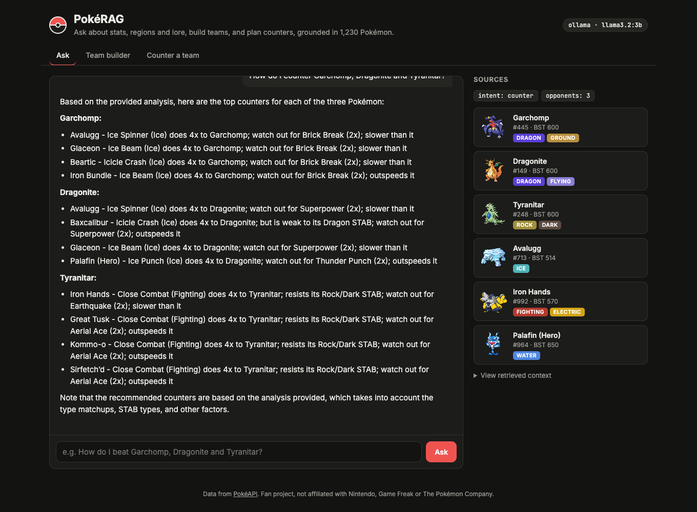
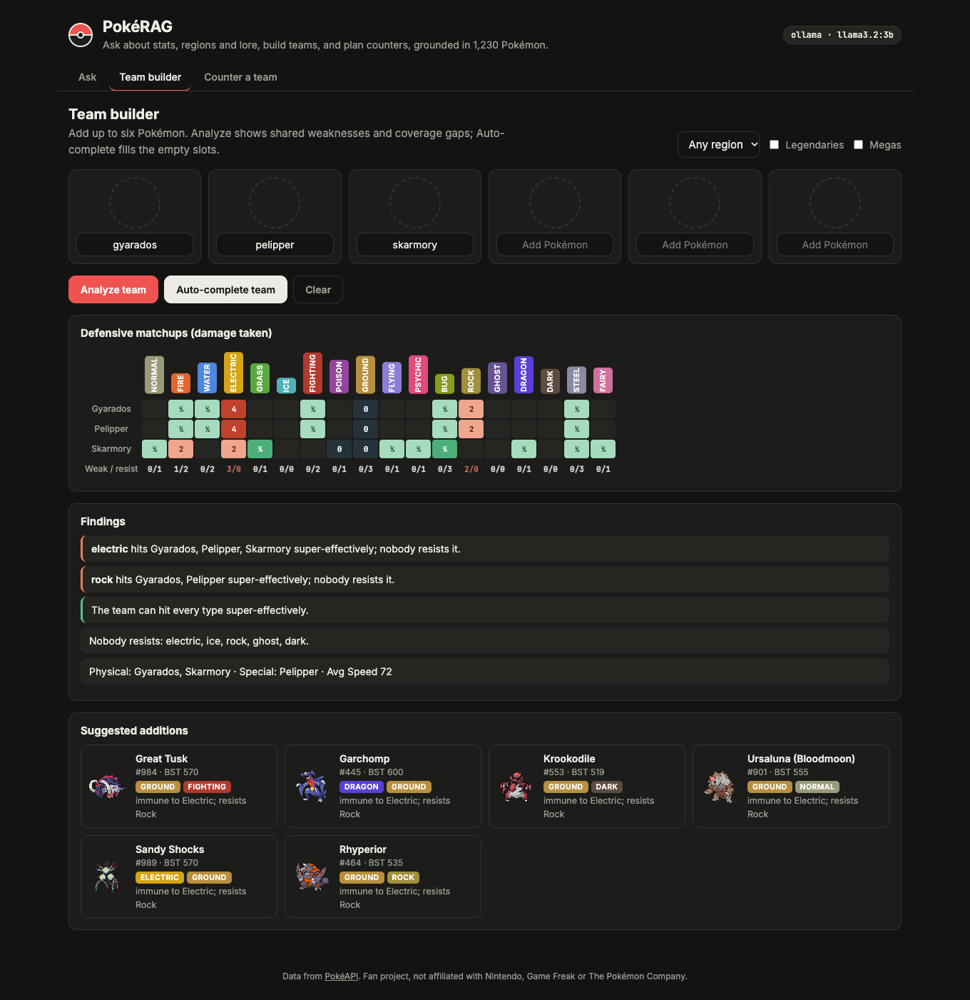
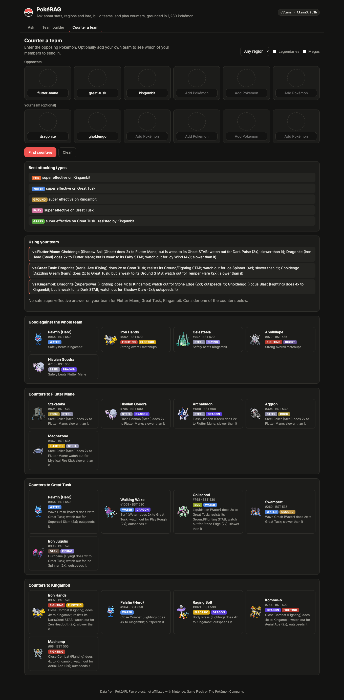
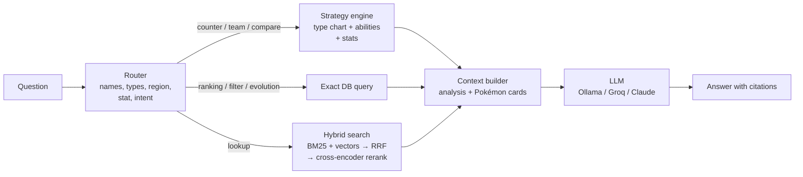

# PokéRAG

A retrieval-augmented generation (RAG) assistant for Pokémon. It answers questions about stats, regions, lore, abilities and moves, builds teams, and plans counters against opposing teams. Answers are grounded in data for 1,230 Pokémon (including regional forms, Megas and battle forms) from [PokéAPI](https://pokeapi.co).

It runs entirely on your own machine for free by default (a local LLM through Ollama), and can switch to a hosted model with one setting.



## What it can do

| Ask | How it's answered |
|---|---|
| *"Which Pokémon dies if the flame on its tail goes out?"* | Hybrid search over Pokédex entries, then the LLM answers from the retrieved cards |
| *"Who is the fastest non-legendary Water type?"* | Exact database ranking (no guessing by the LLM) |
| *"How do I counter Garchomp, Dragonite and Tyranitar?"* | Type-chart engine scores every Pokémon against each opponent |
| *"My team is Charizard, Gyarados and Pikachu. How do I beat Gengar?"* | Splits *your* team from the opponent, picks which of your members to send in, and flags gaps |
| *"Build me a Paldea team around Garchomp"* | Greedy team builder that patches shared weaknesses and coverage gaps, restricted to a region |
| *"Garchomp vs Salamence"*, *"Is Dragapult faster than Garchomp?"* | Side-by-side stats with the leader in each, weaknesses, and a computed one-on-one matchup verdict |
| *"Which Pokémon evolve with a Moon Stone?"*, *"What level does Gible evolve?"* | Exact lookup over structured evolution steps (level, item, held item, trade, friendship, time, location) |
| *"Is Weavile or Mamoswine better against Garchomp?"* | Ranks just your candidates against the opponent |
| *"Which Fire types learn Will-O-Wisp?"*, *"Pokémon with Intimidate in Paldea"*, *"Ground types under 50 kg"*, *"Water types with Speed over 100"* | Exact database filter combining type, region, move, ability, weight/height and stat thresholds |
| *"Tell me about the Johto region"* | Region cards: games, regional Pokédexes, starters, legendaries, regional forms |

The web UI also has a **Team builder** (weakness heatmap, findings, suggested additions) and a **Counter a team** tool that work without the LLM at all.

<p>
  
  
</p>

## How it works



**1. Query routing (`router.py`).** Fast rule-based parsing finds Pokémon names (including "Alolan Ninetales", "Mega Charizard X", "Wash Rotom", typos in the team builder), types, regions or generations, stat words ("fastest", "bulkiest"), evolution items ("Moon Stone", "King's Rock"), filter conditions ("learns Earthquake", "with Levitate", "under 50 kg", "Speed over 100") and the intent (lookup, ranking, filter, team, counter, compare or evolution). Rules are used instead of an extra LLM call so routing is instant, free and behaves the same with a 3B local model as with a large hosted one.

**2. Don't let the LLM do math.** Team analysis and counters are computed in plain Python (`strategy.py`): the full 18-type chart, STAB, the strongest sensible move of each type a Pokémon can learn, speed and bulk, and abilities that grant immunities (Levitate, Flash Fire, Water Absorb, ...) when the Pokémon is guaranteed to have them. The LLM receives these results as an `ANALYSIS` block and explains them. Small models are bad at multiplying type matchups; this keeps recommendations correct and reproducible.

**3. Hybrid retrieval with reranking (`retrieve.py`, `index.py`).** Free-text questions go through:
- **BM25** keyword search (implemented from scratch, ~30 lines)
- **Vector search** with `bge-small-en-v1.5` embeddings in ChromaDB
- **Reciprocal rank fusion** of the two, then a **cross-encoder reranker** (`ms-marco-MiniLM-L-12-v2`) over the top 20

**4. Small-to-big chunks.** Each Pokémon is embedded as two short chunks, a profile chunk and a lore chunk built from its Pokédex entries, so each embedding stays focused. When a chunk matches, the LLM gets the Pokémon's full card (stats, abilities, matchups, evolution, moves, lore) instead of the fragment.

**5. Grounded generation (`rag.py`).** The prompt tells the model to answer only from the context, trust the computed analysis, and cite sources like `[Garchomp]`. The UI streams the answer and shows the source cards, how the question was understood, and the exact retrieved context.

## Evaluation

`python -m eval.run_eval` runs a retrieval benchmark: 44 questions that paraphrase Pokédex entries, ability and move effects, and region facts **without naming the answer** (e.g. *"carries a mask of the face it had back when it was human"* → Yamask).

| Retriever | Hit@1 | Hit@5 | MRR |
|---|---:|---:|---:|
| BM25 only | 79.5% | 97.7% | 0.859 |
| Vector only | 52.3% | 68.2% | 0.571 |
| Hybrid (RRF) | 65.9% | 95.5% | 0.777 |
| **Hybrid + cross-encoder rerank** (default) | **84.1%** | **100%** | **0.915** |

Takeaways:
- On this domain, keyword search beat dense embeddings by a wide margin. Pokédex lore is full of distinctive words ("skull", "keystone", "spoons") that BM25 matches exactly.
- Naive fusion *hurt* Hit@1 compared to BM25 alone, because the weaker vector ranking dragged results down.
- A cross-encoder reranker recovered that and beat both retrievers. I compared four rerankers; MiniLM-L12 was best and adds about 300 ms per search on a laptop CPU.

`python -m eval.run_eval --e2e` also runs 15 end-to-end questions through the whole pipeline and checks the answers contain the expected facts. With the default local `llama3.2:3b`: **15/15 passed** (1–16 s per answer on an M-series Mac).

Caveats: both eval sets are small and hand-written, so treat these numbers as a sanity check rather than a benchmark. The end-to-end check looks for expected keywords in the answer; it doesn't grade full correctness.

`pytest` runs 64 unit tests for the type chart, name matching, routing, strategy engine, comparisons, evolutions and filters.

## Quick start

Requires Python 3.10–3.12 (the ML libraries don't support 3.13+ everywhere yet).

```bash
python3.12 -m venv .venv && source .venv/bin/activate
pip install -r requirements.txt

# Download PokéAPI data (~4,000 cached requests, ~2 min), build the dataset and vector index (~2 min)
python -m pokedex_rag.cli ingest

# Free local LLM
brew install ollama && brew services start ollama
ollama pull llama3.2:3b

python -m pokedex_rag.cli serve      # http://localhost:8000
python -m pokedex_rag.cli ask "How do I beat Gengar?"
python -m pokedex_rag.cli chat       # terminal chat; add --debug to see retrieved context
```

## Choosing an LLM (and what it costs)

Copy `.env.example` to `.env` and set `LLM_PROVIDER`:

| Provider | Cost | Notes |
|---|---|---|
| `ollama` (default) | Free | Runs locally. `llama3.2:3b` is fast but can over-explain or add small inaccuracies. Try a 7–8B model if you have the RAM. |
| `openai` | Free tier | Any OpenAI-compatible API. Defaults to Groq (`llama-3.3-70b-versatile`); get a key at console.groq.com. Best option for a hosted demo. |
| `anthropic` | Paid | Claude through the official SDK. Defaults to `claude-opus-5-5`; set `ANTHROPIC_MODEL` to change it. |
| `none` | Free | No generation. Returns the retrieved context and analysis. |

The Team builder and Counter tools never call the LLM.

## Project structure

```
pokedex_rag/
  fetch.py      Download and cache PokéAPI resources (async, rate-friendly)
  build.py      Clean them into one dataset: forms, evolutions, regions, best moves, matchups
  store.py      In-memory Pokédex: name matching, filters, rankings, text cards for the LLM
  typechart.py  Type effectiveness and ability-based immunities
  strategy.py   Team analysis, counters, team building, comparisons
  router.py     Rule-based query understanding
  index.py      Chunking and the Chroma vector index
  retrieve.py   BM25, hybrid search, reranking, context assembly
  llm.py        Ollama / OpenAI-compatible / Anthropic / none backends (streaming)
  rag.py        The pipeline and system prompt
  server.py     FastAPI: streaming /api/ask, team and counter endpoints
  cli.py        ingest | ask | chat | serve
web/            Vanilla HTML/CSS/JS front end (no build step)
eval/           Retrieval and end-to-end evals
tests/          Unit tests
```

## Limitations

- Matchups are type-based. They account for STAB, learnable coverage moves, speed, bulk and guaranteed ability immunities, but not items, EVs and natures, Tera types, weather or full movesets. Counter scores are a well-reasoned starting point, not a battle simulator.
- Learnsets merge every game, so a "best move" might not be available in the specific game you're playing.
- Regional forms don't get their own Pokédex lore (PokéAPI attaches the entries to the species).

## Credits

Data from [PokéAPI](https://pokeapi.co), sprites from the PokéAPI sprites repository. This is a fan project for learning purposes, not affiliated with Nintendo, Game Freak or The Pokémon Company.
